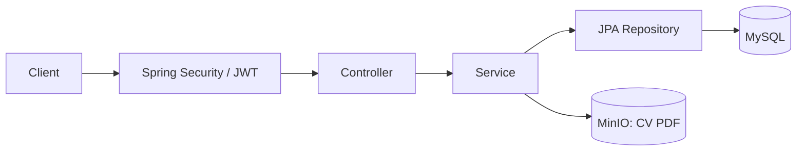
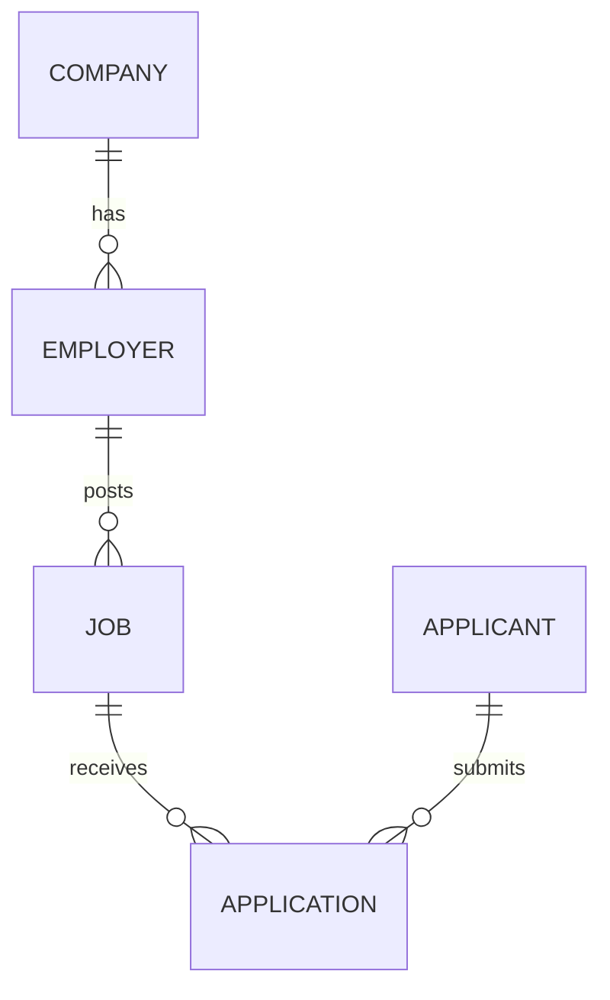

# Job Application System

Backend quản lý tuyển dụng và ứng tuyển cho học phần Kiến trúc phần mềm.

## Chức năng

- **Khách:** tìm kiếm, lọc và xem chi tiết việc làm đang tuyển.
- **Ứng viên:** đăng ký, đăng nhập, cập nhật hồ sơ, nộp CV, xem và rút đơn ứng tuyển.
- **Nhà tuyển dụng:** đăng ký kèm công ty, quản lý tin tuyển dụng, xem đơn và cập nhật kết quả.

Chỉ tin `OPEN` nhận đơn và xuất hiện trên API công khai. Mỗi ứng viên có tối đa một đơn cho mỗi tin. Xóa tin tuyển dụng chuyển trạng thái sang `CLOSED`; rút đơn ứng tuyển xóa bản ghi đơn.

CV dùng định dạng PDF, tối đa 5 MB. Tổng request tải lên cũng bị giới hạn 5 MB. Trạng thái đơn gồm `PENDING`, `REVIEWING`, `INTERVIEW`, `OFFERED`, `REJECTED`.

## Công nghệ

Java 21 · Spring Boot 3.2.4 · Maven · MySQL 8.0.36 · Spring Data JPA · Flyway · Spring Security · JWT · MinIO · Swagger UI.

Kiểm thử bằng JUnit, Mockito, MockMvc và k6. Đóng gói bằng Docker Compose.

## Kiến trúc



- **Controller:** nhận request, kiểm tra dữ liệu và trả response.
- **Service:** xử lý nghiệp vụ và quyền sở hữu tài nguyên.
- **Repository:** truy vấn dữ liệu qua JPA.
- **Security:** xác thực JWT, phân quyền `APPLICANT` và `EMPLOYER`. Mật khẩu được băm bằng BCrypt.

### Dữ liệu



MySQL lưu tài khoản, công ty, tin tuyển dụng, đơn và metadata CV. MinIO lưu tệp CV; bucket được tạo khi tải tệp lần đầu. API hiện trả metadata, chưa có endpoint tải CV.

Flyway chạy migration khi khởi động; Hibernate kiểm tra schema bằng `ddl-auto: validate`. Dữ liệu Docker nằm trong hai volume `mysql_data` và `minio_data`.

### Thư mục

```text
src/main/java/com/example/jobapp/
├── config/         # Security, OpenAPI, MinIO
├── controller/     # REST API
├── dto/            # Request, response
├── entity/         # Entity, enum
├── exception/      # Xử lý lỗi
├── repository/     # Truy cập dữ liệu
├── security/       # JWT, filter
└── service/        # Nghiệp vụ
src/main/resources/
├── application.yml
└── db/migration/   # Flyway SQL
src/test/           # Kiểm thử
kaggle-load-test/    # k6, notebook, seed, kết quả
docs/               # Tài liệu dự án
```

## Cài đặt

Các lệnh dưới đây dùng PowerShell, chạy tại thư mục gốc dự án.

### Docker Compose

Cần Git, Docker với Linux containers và Docker Compose. Các cổng mặc định: `8080`, `3306`, `9000`, `9001`.

```powershell
git clone https://github.com/daohuyhoang06/job-application-system.git
cd job-application-system
Copy-Item .env.example .env
docker compose up -d --build
docker compose logs -f job-backend
```

Giữ lại `.env` nếu đã cấu hình. Trên Linux/macOS, dùng `cp` thay cho `Copy-Item`. Đổi mật khẩu và `JWT_SECRET` mẫu trước khi triển khai.

| Dịch vụ | Địa chỉ mặc định |
| --- | --- |
| API | `http://localhost:8080/api` |
| Swagger UI | [localhost:8080/swagger-ui.html](http://localhost:8080/swagger-ui.html) |
| OpenAPI JSON | [localhost:8080/v3/api-docs](http://localhost:8080/v3/api-docs) |
| MySQL | `localhost:3306`, database `job_application_db` |
| MinIO API | `http://localhost:9000` |
| MinIO Console | [localhost:9001](http://localhost:9001) |

MinIO Console dùng tài khoản `MINIO_ROOT_USER` / `MINIO_ROOT_PASSWORD` trong `.env`. Database mới chưa có tin tuyển dụng.

```powershell
# Kiểm tra API
Invoke-RestMethod 'http://localhost:8080/api/jobs?page=0&size=10'

# Dừng dịch vụ, giữ dữ liệu
docker compose down
```

`docker compose down -v` sẽ xóa cả database và CV trong volume.

### Maven

Cần JDK 21, Maven và `JAVA_HOME` trỏ tới JDK. Dự án chưa có Maven Wrapper.

Khởi động MySQL và MinIO bằng Compose. Nếu backend Docker đang chạy, dừng bằng `docker compose stop job-backend` để giải phóng cổng `8080`.

```powershell
docker compose up -d mysql minio
```

Spring Boot không tự đọc `.env`. Đặt biến trong terminal chạy Maven, khớp với cấu hình Docker. Ví dụ dùng giá trị từ `.env.example`:

```powershell
$env:SPRING_DATASOURCE_URL = 'jdbc:mysql://localhost:3306/job_application_db?useSSL=false&serverTimezone=UTC&allowPublicKeyRetrieval=true'
$env:SPRING_DATASOURCE_USERNAME = 'job_db_user'
$env:SPRING_DATASOURCE_PASSWORD = 'job_db_password'
$env:JWT_SECRET = 'super_secret_jwt_key_that_should_be_at_least_256_bits_long'
$env:JWT_EXPIRATION = '86400000'
$env:MINIO_ENDPOINT = 'http://localhost:9000'
$env:MINIO_BUCKET = 'job-cvs'
$env:MINIO_ACCESS_KEY = 'minio_admin'
$env:MINIO_SECRET_KEY = 'change_this_minio_password'
mvn spring-boot:run
```

Nếu đổi cổng Docker, sửa URL local tương ứng. Trên Linux/macOS, đặt biến bằng `export TEN_BIEN='gia_tri'`.

### Biến môi trường

Giá trị mẫu nằm trong [.env.example](.env.example); cấu hình backend nằm trong [application.yml](src/main/resources/application.yml).

| Biến trong `.env` | Ý nghĩa |
| --- | --- |
| `DB_ROOT_PASSWORD` | Mật khẩu root MySQL |
| `DB_NAME`, `DB_USER`, `DB_PASSWORD` | Database và tài khoản ứng dụng |
| `DB_PORT` | Cổng MySQL trên máy host |
| `JWT_SECRET` | Khóa ký JWT, ít nhất 32 byte |
| `JWT_EXPIRATION` | Thời hạn token theo mili giây; mặc định `86400000` (24 giờ) |
| `MINIO_ROOT_USER`, `MINIO_ROOT_PASSWORD` | Tài khoản MinIO |
| `MINIO_BUCKET` | Bucket lưu CV |
| `MINIO_API_PORT`, `MINIO_CONSOLE_PORT` | Cổng API và Console trên máy host |

Compose chuyển các biến này thành `SPRING_DATASOURCE_*`, `JWT_*`, `MINIO_*` cho backend. Trong mạng Docker, backend kết nối tới `mysql:3306` và `minio:9000`; khi chạy Maven, dùng `localhost` và cổng host.

## API

Xem request/response và thử API tại Swagger UI. [Danh sách endpoint](docs/ENDPOINTS.md) được lưu trong `docs/`.

| Nhóm | Endpoint | Quyền |
| --- | --- | --- |
| Đăng ký, đăng nhập | `/api/auth/applicants/*`, `/api/auth/employers/*` | Công khai |
| Tìm việc, xem chi tiết | `/api/jobs`, `/api/jobs/{jobId}` | Công khai, `GET` |
| Hồ sơ cá nhân | `/api/applicants/me` | `APPLICANT` |
| Nộp đơn | `/api/jobs/{jobId}/applications` | `APPLICANT`, `POST` |
| Quản lý đơn cá nhân | `/api/applications/me`, `/api/applications/{applicationId}` | `APPLICANT` |
| Quản lý tin tuyển dụng | `/api/employer/jobs`, `/api/employer/jobs/{jobId}` | `EMPLOYER` |
| Xem đơn theo tin | `/api/employer/jobs/{jobId}/applications` | `EMPLOYER` |
| Xem đơn, cập nhật trạng thái | `/api/employer/applications/{applicationId}`, `/api/employer/applications/{applicationId}/status` | `EMPLOYER` |

`GET /api/jobs` nhận `keyword`, `location`, `category`, `level`, `salaryMin`, `page`, `size`. Cấp bậc: `INTERN`, `FRESHER`, `JUNIOR`, `SENIOR`. Trang bắt đầu từ `0`; kích thước trang công khai mặc định 10, tối đa 20. Danh sách tin của nhà tuyển dụng mặc định 20, tối đa 100.

Đăng nhập trả `accessToken`. Gửi token trong header hoặc nhập vào **Authorize** trên Swagger:

```http
Authorization: Bearer <accessToken>
```

### Thử nghiệp vụ trên Swagger

1. Đăng ký và đăng nhập nhà tuyển dụng; dùng token để tạo tin qua `POST /api/employer/jobs`.
2. Đăng ký và đăng nhập ứng viên; đổi sang token ứng viên.
3. Nộp đơn qua `POST /api/jobs/{jobId}/applications`: chọn CV PDF ở trường `file`, thêm `coverLetter` nếu cần.
4. Đổi sang token nhà tuyển dụng để xem đơn và cập nhật `status`.

Các API dùng JSON, riêng nộp đơn dùng `multipart/form-data`. Mật khẩu đăng ký dài 8–72 ký tự, có chữ cái và chữ số.

## Kiểm thử

```powershell
mvn test
mvn clean package
java -jar target/job-application-system-0.0.1-SNAPSHOT.jar
```

Chạy JAR cần cấu hình MySQL, MinIO và biến môi trường như khi chạy Maven. `mvn clean package` chạy test; Dockerfile dùng `-DskipTests`, cần chạy test riêng trước khi build image.

Các test hiện có kiểm tra service, JWT và controller bằng mock/MockMvc.

### Kiểm thử tải

| Script trong `kaggle-load-test/` | Nội dung | Tải đỉnh | Thời lượng |
| --- | --- | --- | --- |
| `test_scenario1_baseline_read.js` | Danh sách, tìm kiếm, chi tiết tin | 50 VU | 40 giây |
| `test_scenario2_stress_test.js` | Tăng tải đọc | 300 VU | 60 giây |
| `test_scenario3_auth_and_write.js` | Đăng ký, đăng nhập, đọc hồ sơ | 30 VU | 40 giây |

Cần k6 và backend tại `http://localhost:8080/api`. Hai kịch bản đọc chọn job ID từ 1 đến 50; nạp [seed SQL](kaggle-load-test/seed_data.sql) vào database kiểm thử sau khi Flyway chạy xong:

```powershell
docker compose cp ./kaggle-load-test/seed_data.sql mysql:/tmp/jobapp-seed.sql
docker compose exec mysql sh -c 'mysql --default-character-set=utf8mb4 -u"$MYSQL_USER" -p"$MYSQL_PASSWORD" "$MYSQL_DATABASE" < /tmp/jobapp-seed.sql'
k6 run ./kaggle-load-test/test_scenario1_baseline_read.js
k6 run ./kaggle-load-test/test_scenario2_stress_test.js
k6 run ./kaggle-load-test/test_scenario3_auth_and_write.js
```

Seed dùng ID cố định; nạp vào database kiểm thử riêng. Kịch bản 3 tạo thêm tài khoản sau mỗi lần chạy.

Để chạy trên Kaggle CPU, đưa JAR và seed vào Dataset, bật Internet rồi chạy [notebook](kaggle-load-test/phase1_load_test.ipynb). Notebook chưa khởi động MinIO; ba kịch bản này không tải CV.

[Kết quả Pha 1](kaggle-load-test/results/phase1/) có ba lần chạy cho mỗi kịch bản. Tổng hợp bằng:

```powershell
python -X utf8 ./kaggle-load-test/results/aggregate_results.py all
```

## Lỗi thường gặp

| Lỗi | Cách xử lý |
| --- | --- |
| Backend chưa kết nối được MySQL | Xem `docker compose logs mysql job-backend`; chờ MySQL sẵn sàng rồi `docker compose restart job-backend`. Compose chưa có healthcheck |
| Đổi `.env` nhưng MySQL vẫn dùng mật khẩu cũ | Cập nhật tài khoản trong MySQL; biến khởi tạo không ghi đè cấu hình trong volume cũ |
| Maven báo lỗi Java | Kiểm tra `JAVA_HOME`, `java -version` và `mvn -version`; cần JDK 21 |
| API trả `401` / `403` | Kiểm tra Bearer token, hạn token và vai trò tài khoản |
| Nộp CV trả `400` / `413` / `503` | Kiểm tra PDF, dung lượng, trường `file`; với `503`, kiểm tra kết nối và tài khoản MinIO |

## Tài liệu

- [Yêu cầu bài tập](docs/yeu_cau.md)
- [API](docs/ENDPOINTS.md)
- [Kế hoạch Pha 1](docs/PLAN.md)
- Kế hoạch chức năng: [xác thực](docs/AUTH_PLAN.md), [tin tuyển dụng](docs/EMPLOYER_JOBS_PLAN.md), [đơn ứng tuyển](docs/APPLICANT_EMPLOYER_APPLICATIONS_PLAN.md)
