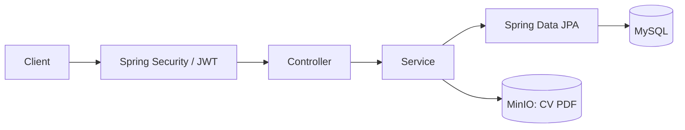

# Job Application System

Backend cho hệ thống tuyển dụng, viết bằng Java và Spring Boot. Ứng viên tìm việc, nộp CV và theo dõi đơn ứng tuyển. Nhà tuyển dụng đăng tin, xem hồ sơ và cập nhật kết quả xử lý.

## Chức năng

| Người dùng | Chức năng |
| --- | --- |
| Khách | Tìm kiếm, lọc và xem chi tiết việc làm đang tuyển |
| Ứng viên (`APPLICANT`) | Đăng ký, đăng nhập, sửa hồ sơ, nộp CV, xem và rút đơn |
| Nhà tuyển dụng (`EMPLOYER`) | Đăng ký kèm thông tin công ty, quản lý tin tuyển dụng và xử lý đơn |

Chỉ tin `OPEN` được hiển thị công khai và nhận đơn mới. Khi nhà tuyển dụng xóa tin, hệ thống chuyển tin sang `CLOSED` và giữ lại các đơn đã nộp.

Mỗi ứng viên chỉ có một đơn cho cùng một tin tại một thời điểm. Sau khi rút đơn, ứng viên có thể nộp lại nếu tin còn mở. CV dùng định dạng PDF; file và toàn bộ request multipart đều bị giới hạn 5 MiB.

## Công nghệ

- Java 21, Spring Boot 3.2.4, Maven.
- MySQL 8.0.36, Spring Data JPA, Flyway.
- Spring Security, JWT, BCrypt.
- MinIO lưu CV; Swagger UI dùng để xem và thử API.
- JUnit 5, Mockito, MockMvc và k6.
- Docker Compose chạy backend, MySQL và MinIO.

## Chạy dự án

Cài Git, Docker và Docker Compose v2. Nếu chạy bằng Docker, máy host không cần Java hoặc Maven.

```powershell
git clone https://github.com/daohuyhoang06/job-application-system.git
cd job-application-system
Copy-Item .env.example .env
docker compose up -d --build
docker compose logs -f job-backend
```

Trên Linux/macOS, dùng `cp .env.example .env` thay cho `Copy-Item`. File `.env.example` chứa cấu hình local; đổi mật khẩu và khóa JWT trước khi dùng trên server.

Sau khi backend khởi động, mở Swagger UI hoặc gọi `GET /api/jobs`. Database mới chưa có dữ liệu nên API trả danh sách rỗng.

| Dịch vụ | Địa chỉ mặc định |
| --- | --- |
| API việc làm | [http://localhost:8080/api/jobs](http://localhost:8080/api/jobs) |
| Swagger UI | [http://localhost:8080/swagger-ui.html](http://localhost:8080/swagger-ui.html) |
| OpenAPI JSON | [http://localhost:8080/v3/api-docs](http://localhost:8080/v3/api-docs) |
| MySQL | `localhost:3306`, database `job_application_db` |
| MinIO API | `http://localhost:9000` |
| MinIO Console | [http://localhost:9001](http://localhost:9001) |

Dùng `docker compose down` để dừng; dữ liệu trong volume được giữ lại. Nếu backend lỗi kết nối ở lần khởi động đầu, chờ MySQL sẵn sàng rồi chạy `docker compose restart job-backend`.

Cách chạy backend bằng Maven, danh sách biến môi trường và lỗi thường gặp nằm trong [SETUP.md](docs/phase_1/SETUP.md).

## Thử API trên Swagger

1. Đăng ký và đăng nhập nhà tuyển dụng qua nhóm `/api/auth/employers/*`.
2. Nhập `accessToken` vào **Authorize**, tạo tin bằng `POST /api/employer/jobs` và lưu lại `id`.
3. Đăng ký và đăng nhập ứng viên qua nhóm `/api/auth/applicants/*`, sau đó đổi token trong **Authorize**.
4. Gọi `POST /api/jobs/{jobId}/applications`, chọn CV PDF ở trường `file`. `coverLetter` là phần tùy chọn.
5. Đổi về token nhà tuyển dụng, xem đơn và cập nhật trạng thái qua `PATCH /api/employer/applications/{applicationId}/status`.
6. Dùng token ứng viên gọi `GET /api/applications/me` để xem trạng thái mới.

Đăng ký xong cần đăng nhập để lấy token. Với HTTP client, truyền token qua header:

```http
Authorization: Bearer <accessToken>
```

[ENDPOINTS.md](docs/phase_1/ENDPOINTS.md) mô tả 20 endpoint, kèm body mẫu, response và mã lỗi.

## Kiến trúc



Controller nhận request, service xử lý nghiệp vụ và kiểm tra quyền sở hữu, repository truy cập MySQL qua JPA. File CV lưu trên MinIO; MySQL giữ thông tin đơn và metadata của file. Flyway quản lý schema, Hibernate dùng `ddl-auto: validate`.

```text
src/main/java/com/example/jobapp/
├── config/         # Security, OpenAPI, MinIO
├── controller/     # REST API
├── dto/            # Request và response
├── entity/         # JPA entity và enum
├── exception/      # Xử lý lỗi
├── repository/     # Truy vấn dữ liệu
├── security/       # JWT và filter
└── service/        # Nghiệp vụ
src/main/resources/
├── application.yml
└── db/migration/   # Flyway SQL
src/test/           # Unit test, MockMvc
kaggle-load-test/    # Script k6, notebook, seed và kết quả
```

## Kiểm thử

Với JDK 21 và Maven:

```powershell
mvn test
mvn clean package
```

Các test dùng Mockito và MockMvc. Dockerfile bỏ qua test khi build image; chạy `mvn test` trước khi build.

Năm kịch bản k6 và bảng kết quả đã lưu được trình bày trong [TESTING.md](docs/phase_1/TESTING.md), kèm hướng dẫn chạy trên Kaggle CPU.

## Tài liệu

Xem [mục lục tài liệu](docs/README.md) để đọc theo từng pha: bài toán, kiến trúc, dữ liệu, API, cài đặt và kiểm thử. [Yêu cầu bài tập](docs/yeu_cau.md) và [ý tưởng Pha 2](docs/phase_2/PHASE2_IDEAS.md) được lưu riêng.
