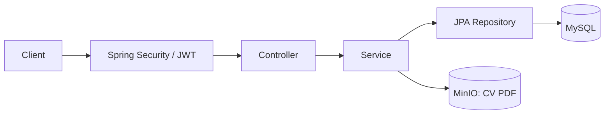
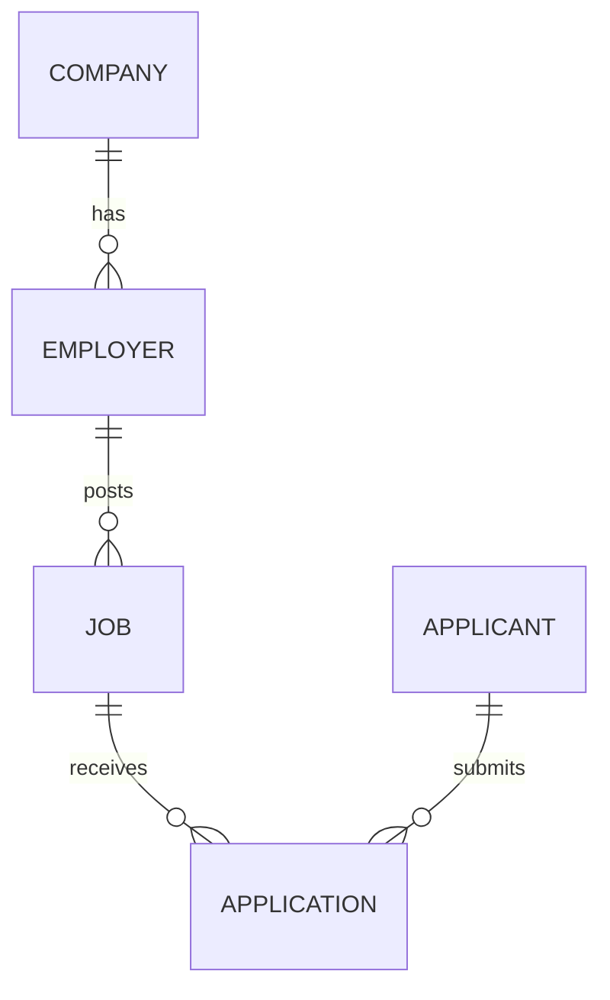

# Job Application System

Job Application System- Hệ thống tập trung quy trình tuyển dụng, giúp ứng viên tìm việc, nộp và theo dõi đơn ứng tuyển; đồng thời hỗ trợ nhà tuyển dụng đăng tin và xử lý hồ sơ.

## Chức năng

- **Khách:** tìm kiếm, lọc và xem chi tiết việc làm đang tuyển.
- **Ứng viên:** đăng ký, đăng nhập, cập nhật hồ sơ, nộp CV, xem và rút đơn ứng tuyển.
- **Nhà tuyển dụng:** đăng ký kèm công ty, quản lý tin tuyển dụng, xem đơn và cập nhật kết quả.

### Quy tắc nghiệp vụ

- Tin tuyển dụng ở trạng thái `OPEN` được hiển thị trên API công khai và cho phép ứng viên nộp đơn.
- Khi nhà tuyển dụng xóa một tin, hệ thống không xóa tin khỏi cơ sở dữ liệu mà chuyển trạng thái sang `CLOSED`. Tin này không còn xuất hiện trên API công khai, không nhận đơn mới, nhưng các đơn đã nộp vẫn được giữ lại.
- Trong khi đơn ứng tuyển còn tồn tại, mỗi ứng viên chỉ có thể có một đơn cho cùng một tin; hệ thống từ chối việc nộp trùng.
- Khi ứng viên rút đơn, hệ thống xóa bản ghi đơn ứng tuyển. Nếu tin vẫn ở trạng thái `OPEN`, ứng viên có thể nộp lại một đơn mới.
- Ứng viên chỉ được truy cập hồ sơ và đơn ứng tuyển của mình. Nhà tuyển dụng chỉ được quản lý tin tuyển dụng và các đơn thuộc những tin do mình đăng.

CV dùng định dạng PDF, tối đa 5 MB.

Trạng thái đơn gồm `PENDING`, `REVIEWING`, `INTERVIEW`, `OFFERED`, `REJECTED`.

## Phạm vi

Phiên bản hiện tại tập trung vào backend API, chưa bao gồm giao diện người dùng, quản trị viên, thông báo, nhắn tin, lịch phỏng vấn, gợi ý việc làm hoặc phân tích CV tự động.

## Công nghệ

Java 21 · Spring Boot 3.2.4 · Maven · MySQL 8.0.36 · Spring Data JPA · Flyway · Spring Security · JWT · MinIO · Swagger UI.

Kiểm thử bằng JUnit, Mockito, MockMvc và k6. Đóng gói bằng Docker Compose.

## Kiến trúc



- **Controller:** nhận request, kiểm tra dữ liệu và trả response.
- **Service:** xử lý nghiệp vụ và quyền sở hữu tài nguyên.
- **Repository:** truy vấn dữ liệu qua JPA.
- **Security:** xác thực JWT, phân quyền `APPLICANT` và `EMPLOYER`. Mật khẩu được băm bằng BCrypt.

### Dữ liệu



Hệ thống lưu dữ liệu nghiệp vụ trong MySQL, bao gồm tài khoản, công ty, tin tuyển dụng, đơn ứng tuyển và thông tin về CV. Tệp CV được lưu riêng trên MinIO;
Flyway chạy migration khi khởi động; Hibernate kiểm tra schema bằng `ddl-auto: validate`. Dữ liệu Docker nằm trong hai volume `mysql_data` và `minio_data`.

### Thư mục

```text
src/main/java/com/example/jobapp/
├── config/         # Security, OpenAPI, MinIO
├── controller/     # REST API
├── dto/            # Request, response
├── entity/         # Entity, enum
├── exception/      # Xử lý lỗi
├── repository/     # Truy cập dữ liệu
├── security/       # JWT, filter
└── service/        # Nghiệp vụ
src/main/resources/
├── application.yml
└── db/migration/   # Flyway SQL
src/test/           # Kiểm thử
kaggle-load-test/    # k6, notebook, seed, kết quả
docs/               # Tài liệu dự án
```

## Cài đặt

### Docker Compose

```powershell
git clone https://github.com/daohuyhoang06/job-application-system.git
cd job-application-system
Copy-Item .env.example .env
docker compose up -d --build
docker compose logs -f job-backend
```

Sau khi các container khởi động, có thể truy cập các dịch vụ tại:

| Dịch vụ     | Địa chỉ mặc định                                                 |
| ------------- | ---------------------------------------------------------------------- |
| API           | `http://localhost:8080/api`                                          |
| Swagger UI    | [localhost:8080/swagger-ui.html](http://localhost:8080/swagger-ui.html) |
| OpenAPI JSON  | [localhost:8080/v3/api-docs](http://localhost:8080/v3/api-docs)         |
| MySQL         | `localhost:3306`, database `job_application_db`                    |
| MinIO API     | `http://localhost:9000`                                              |
| MinIO Console | [localhost:9001](http://localhost:9001)                                 |

### Maven

Để chạy backend trực tiếp trên máy, cần cài đặt JDK 21 và Maven. MySQL và MinIO vẫn được khởi động bằng Docker Compose:

```powershell
docker compose up -d mysql minio
```

Sau khi hai dịch vụ đã sẵn sàng, khởi động backend:

```powershell
mvn spring-boot:run
```

Cấu hình mặc định trong [application.yml](src/main/resources/application.yml) khớp với các giá trị trong [.env.example](.env.example), nên không cần khai báo thêm biến môi trường khi chạy local.

### Biến môi trường

Giá trị mẫu nằm trong [.env.example](.env.example); cấu hình backend nằm trong [application.yml](src/main/resources/application.yml).

| Biến trong `.env`                         | Ý nghĩa                                                            |
| -------------------------------------------- | -------------------------------------------------------------------- |
| `DB_ROOT_PASSWORD`                         | Mật khẩu root MySQL                                                |
| `DB_NAME`, `DB_USER`, `DB_PASSWORD`    | Database và tài khoản ứng dụng                                  |
| `DB_PORT`                                  | Cổng MySQL trên máy host                                          |
| `JWT_SECRET`                               | Khóa ký JWT, ít nhất 32 byte                                     |
| `JWT_EXPIRATION`                           | Thời hạn token theo mili giây; mặc định `86400000` (24 giờ) |
| `MINIO_ROOT_USER`, `MINIO_ROOT_PASSWORD` | Tài khoản MinIO                                                    |
| `MINIO_BUCKET`                             | Bucket lưu CV                                                       |
| `MINIO_API_PORT`, `MINIO_CONSOLE_PORT`   | Cổng API và Console trên máy host                                |

Compose chuyển các biến này thành `SPRING_DATASOURCE_*`, `JWT_*`, `MINIO_*` cho backend. Trong mạng Docker, backend kết nối tới `mysql:3306` và `minio:9000`; khi chạy Maven, dùng `localhost` và cổng host.

## API

Xem request/response và thử API tại Swagger UI. [Danh sách endpoint](docs/ENDPOINTS.md) được lưu trong `docs/`.

| Nhóm                              | Endpoint                                                                                              | Quyền                  |
| ---------------------------------- | ----------------------------------------------------------------------------------------------------- | ----------------------- |
| Đăng ký, đăng nhập           | `/api/auth/applicants/*`, `/api/auth/employers/*`                                                 | Công khai              |
| Tìm việc, xem chi tiết          | `/api/jobs`, `/api/jobs/{jobId}`                                                                  | Công khai, `GET`     |
| Hồ sơ cá nhân                  | `/api/applicants/me`                                                                                | `APPLICANT`           |
| Nộp đơn                         | `/api/jobs/{jobId}/applications`                                                                    | `APPLICANT`, `POST` |
| Quản lý đơn cá nhân          | `/api/applications/me`, `/api/applications/{applicationId}`                                       | `APPLICANT`           |
| Quản lý tin tuyển dụng         | `/api/employer/jobs`, `/api/employer/jobs/{jobId}`                                                | `EMPLOYER`            |
| Xem đơn theo tin                 | `/api/employer/jobs/{jobId}/applications`                                                           | `EMPLOYER`            |
| Xem đơn, cập nhật trạng thái | `/api/employer/applications/{applicationId}`, `/api/employer/applications/{applicationId}/status` | `EMPLOYER`            |

API danh sách việc làm hỗ trợ tìm kiếm theo từ khóa và lọc theo địa điểm, ngành nghề, cấp bậc hoặc mức lương tối thiểu. Kết quả được phân trang thông qua `page` và `size`.

Đăng nhập trả `accessToken`. Gửi token trong header hoặc nhập vào **Authorize** trên Swagger:

```http
Authorization: Bearer <accessToken>
```

### Thử nghiệp vụ trên Swagger

1. Đăng ký và đăng nhập nhà tuyển dụng; dùng token để tạo tin qua `POST /api/employer/jobs`.
2. Đăng ký và đăng nhập ứng viên; đổi sang token ứng viên.
3. Nộp đơn qua `POST /api/jobs/{jobId}/applications`: chọn CV PDF ở trường `file`, thêm `coverLetter` nếu cần.
4. Đổi sang token nhà tuyển dụng để xem đơn và cập nhật `status`.

Các API dùng JSON, riêng nộp đơn dùng `multipart/form-data`. Mật khẩu đăng ký dài 8–72 ký tự, có chữ cái và chữ số.

## Kiểm thử

```powershell
mvn test
```

Các test hiện có kiểm tra service, JWT và controller bằng mock/MockMvc. Cần dùng JDK 21; có thể kiểm tra phiên bản Java mà Maven đang sử dụng bằng `mvn -version`.

Dockerfile bỏ qua test khi build image, vì vậy nên chạy `mvn test` trước khi build.

### Kiểm thử tải trên Kaggle

| Script trong `kaggle-load-test/`   | Nội dung                               | Tải đỉnh | Thời lượng |
| ------------------------------------ | --------------------------------------- | ----------- | ------------- |
| `test_scenario1_baseline_read.js`  | Danh sách, tìm kiếm, chi tiết tin   | 50 VU       | 40 giây      |
| `test_scenario2_stress_test.js`    | Tăng tải đọc                        | 300 VU      | 60 giây      |
| `test_scenario3_auth_and_write.js` | Đăng ký, đăng nhập, đọc hồ sơ | 30 VU       | 40 giây      |

Quy trình chạy trên Kaggle:

1. Đóng gói backend bằng `mvn clean package`.
2. Đưa tệp JAR trong thư mục `target/` và [seed_data.sql](kaggle-load-test/seed_data.sql) lên Kaggle Dataset.
3. Gắn Dataset vào [notebook](kaggle-load-test/phase1_load_test.ipynb), bật Internet và chạy toàn bộ notebook.
4. Tải các tệp kết quả `summary_scenario*.json` về và lưu theo từng lần chạy trong [results/phase1](kaggle-load-test/results/phase1/).

Dữ liệu seed cung cấp 50 tin tuyển dụng cho hai kịch bản đọc. Ở kịch bản còn lại, mỗi vòng lặp tạo một tài khoản ứng viên mới để kiểm thử đăng ký, đăng nhập và xác thực. Các kịch bản không tải CV nên không cần MinIO.

[Kết quả Pha 1](kaggle-load-test/results/phase1/) có ba lần chạy cho mỗi kịch bản. Tổng hợp bằng:

```powershell
python -X utf8 ./kaggle-load-test/results/aggregate_results.py all
```

## Lỗi thường gặp

| Lỗi                                                  | Cách xử lý                                                                                                                                   |
| ----------------------------------------------------- | ----------------------------------------------------------------------------------------------------------------------------------------------- |
| Backend chưa kết nối được MySQL                 | Xem `docker compose logs mysql job-backend`; chờ MySQL sẵn sàng rồi `docker compose restart job-backend`. Compose chưa có healthcheck |
| Đổi `.env` nhưng MySQL vẫn dùng mật khẩu cũ | Cập nhật tài khoản trong MySQL; biến khởi tạo không ghi đè cấu hình trong volume cũ                                                |
| Maven báo lỗi Java                                  | Kiểm tra `JAVA_HOME`, `java -version` và `mvn -version`; cần JDK 21                                                                    |
| API trả `401` / `403`                            | Kiểm tra Bearer token, hạn token và vai trò tài khoản                                                                                     |
| Nộp CV trả `400` / `413` / `503`              | Kiểm tra PDF, dung lượng, trường `file`; với `503`, kiểm tra kết nối và tài khoản MinIO                                         |

## Tài liệu

- [Yêu cầu bài tập](docs/yeu_cau.md)
- [API](docs/ENDPOINTS.md)
- [Kế hoạch Pha 1](docs/PLAN.md)
