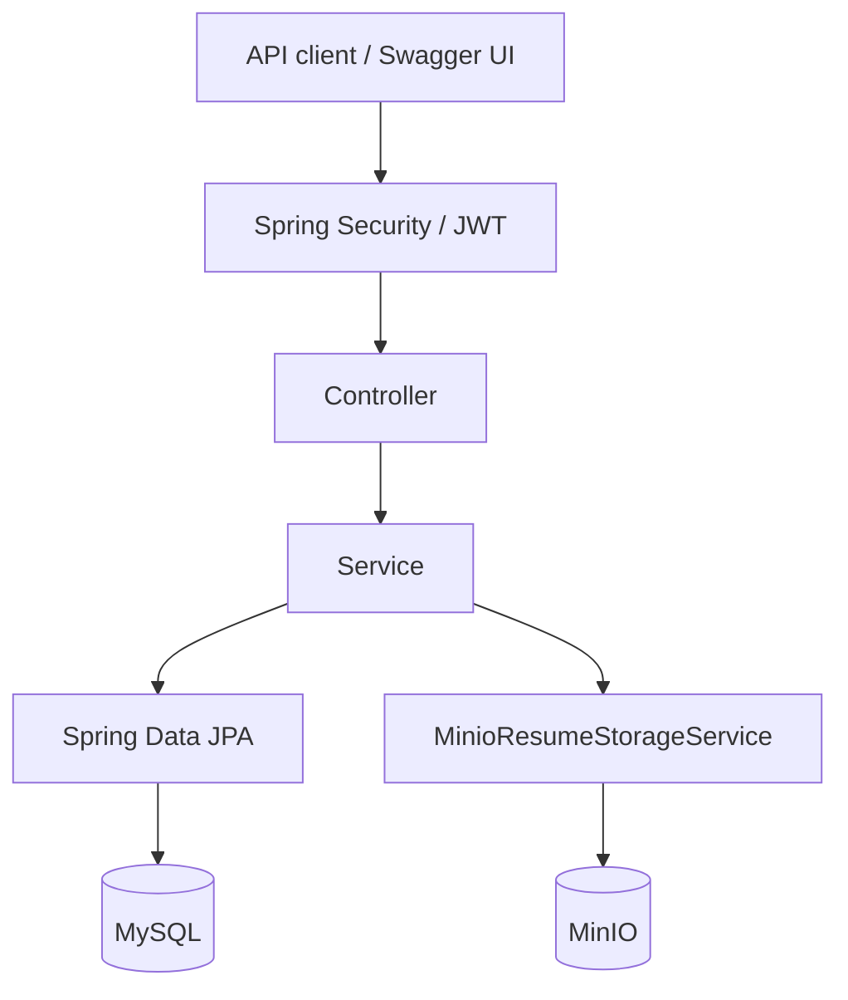
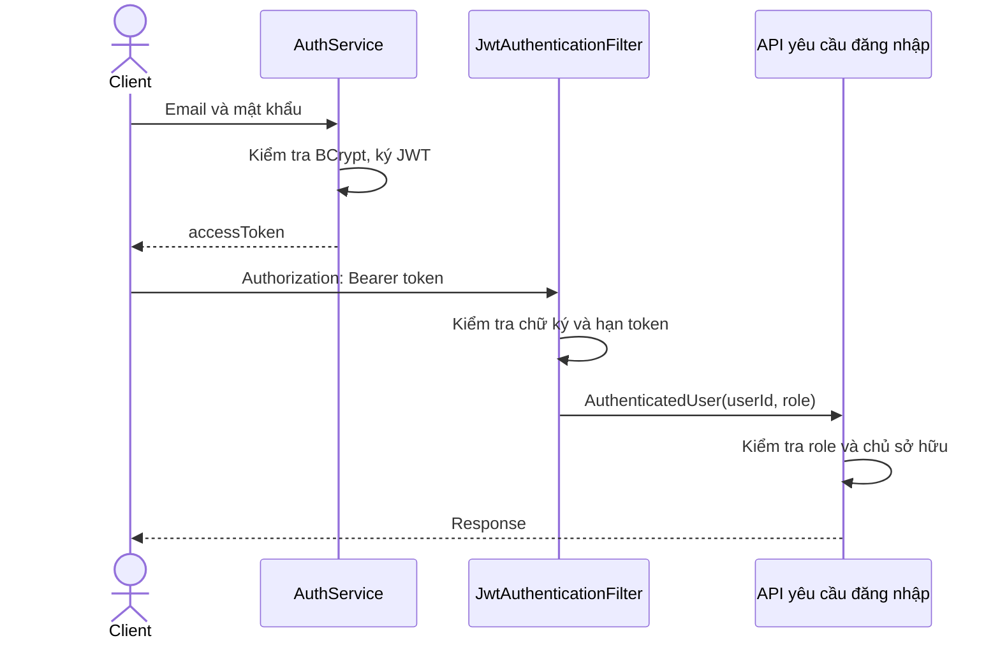

# Kiến trúc hệ thống

[Mục lục](../README.md) · [Cơ sở dữ liệu](DATABASE.md)

## Các thành phần

Backend là một ứng dụng Spring Boot, chia thành ba tầng controller, service và repository. MySQL lưu tài khoản, tin tuyển dụng, đơn ứng tuyển và metadata CV. File PDF lưu riêng trên MinIO.

Docker Compose chạy ba service `job-backend`, `mysql` và `minio` trên mạng `job_network`.

## Tổ chức mã nguồn

Các package nằm trong `src/main/java/com/example/jobapp/`.

| Package | Công việc |
| --- | --- |
| `controller` | Nhận HTTP request, validate DTO, lấy principal và trả response |
| `service` | Xử lý nghiệp vụ, kiểm tra quyền sở hữu và quản lý transaction |
| `repository` | Truy vấn bằng Spring Data JPA và JPQL |
| `entity` | Ánh xạ bảng, quan hệ và enum |
| `dto` | Định nghĩa request/response, tách dữ liệu API khỏi entity |
| `security` | Sinh, xác minh JWT và xử lý lỗi xác thực/phân quyền |
| `config` | Cấu hình Security, OpenAPI và MinIO client |
| `exception` | Exception nghiệp vụ và `GlobalExceptionHandler` |

Service vẫn dùng một số kiểu của framework như `MultipartFile`, `PageRequest` và `Sort`. Phần này cần tách ra nếu áp dụng đầy đủ yêu cầu tầng nghiệp vụ độc lập với framework web/data của bài tập.

## Xác thực và phân quyền

Đăng nhập tìm tài khoản theo email, kiểm tra mật khẩu bằng BCrypt rồi cấp JWT. Token chứa `subject` là ID người dùng, `role`, thời điểm cấp và thời điểm hết hạn.

`JwtAuthenticationFilter` chạy trước `UsernamePasswordAuthenticationFilter`. Token hợp lệ tạo principal có authority `ROLE_APPLICANT` hoặc `ROLE_EMPLOYER`. Endpoint yêu cầu đăng nhập trả `401` khi không xác thực được, `403` khi sai role.

Kiểm tra role nằm trong `SecurityConfig`; kiểm tra chủ sở hữu nằm trong service và truy vấn repository. Ví dụ, sửa tin phải tìm theo cả `jobId` và `employerId` lấy từ JWT. Hai nhà tuyển dụng cùng công ty vẫn chỉ quản lý tin do mình đăng.

Ứng dụng dùng session `STATELESS`, tắt HTTP Basic, form login và CSRF. Filter đọc token mà không truy vấn lại tài khoản. Chưa có refresh token hoặc cơ chế thu hồi token.

Ứng viên và nhà tuyển dụng nằm ở hai bảng riêng. Email duy nhất trong từng bảng; ID có thể trùng số giữa hai bảng và được phân biệt bằng role.

## Các luồng xử lý

### Đăng ký nhà tuyển dụng

`AuthService` tạo công ty mới rồi tạo employer liên kết với công ty đó. Hai thao tác nằm trong cùng transaction MySQL, được rollback cùng nhau nếu có lỗi. API chưa có bước gia nhập công ty đã tồn tại.

### Tìm kiếm việc làm

`PublicJobService` chuẩn hóa bộ lọc và phân trang, sau đó gọi JPQL trong `JobRepository`. Truy vấn lấy tin `OPEN`, sắp xếp `createdAt` giảm dần. Response chứa thông tin tin tuyển dụng và công ty. Mọi request hiện đều đọc từ MySQL.

### Nộp đơn

`ApplicantApplicationService` kiểm tra tin còn mở và ứng viên chưa có đơn trùng. `MinioResumeStorageService` kiểm tra PDF, tạo object key bằng UUID rồi upload. Bucket được tạo khi upload lần đầu nếu chưa tồn tại. Sau đó đơn và metadata được lưu vào MySQL.

MinIO không tham gia transaction MySQL. Service có nhánh xóa object khi lỗi xảy ra trong khối lưu đơn, nhưng chưa xử lý hết lỗi tại thời điểm commit. Rút đơn cũng chưa xóa object. Chi tiết ở [vòng đời CV](DATABASE.md).

## Khởi động và lưu dữ liệu

Flyway chạy migration trong `src/main/resources/db/migration/` khi ứng dụng khởi động. Hibernate dùng `ddl-auto: validate` để kiểm tra schema. MySQL và MinIO lưu dữ liệu trong hai named volume của Compose.

`application.yml` có cấu hình local và nhận biến môi trường. Trong Docker, backend dùng `mysql:3306` và `minio:9000`; khi chạy Maven dùng địa chỉ trên host. Compose chưa có healthcheck nên backend có thể kết nối trước khi MySQL sẵn sàng.
