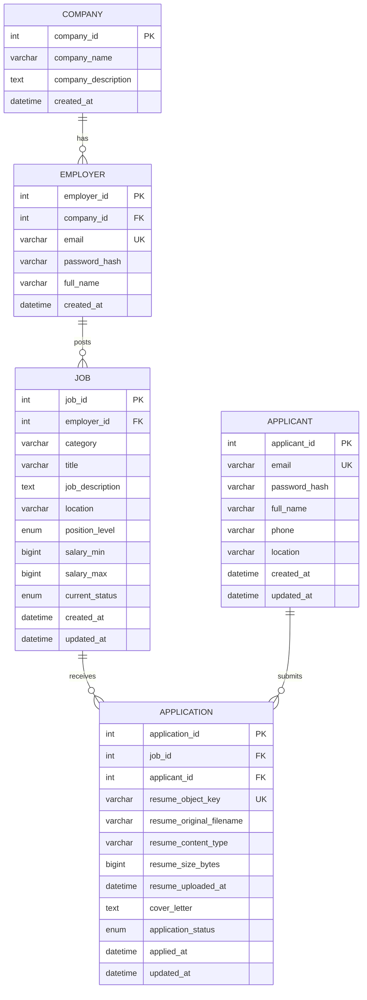

# Cơ sở dữ liệu và lưu trữ CV

[Mục lục tài liệu](../README.md) · [Kiến trúc](ARCHITECTURE.md)

## 1. Migration

Schema được quản lý bằng Flyway:

| Migration | Thay đổi |
| --- | --- |
| [V1__init_schema.sql](../../src/main/resources/db/migration/V1__init_schema.sql) | Tạo năm bảng nghiệp vụ, khóa ngoại, unique constraint và index ban đầu. |
| [V2__replace_resume_url_with_minio_metadata.sql](../../src/main/resources/db/migration/V2__replace_resume_url_with_minio_metadata.sql) | Đổi `resume_url` thành `resume_object_key`, bổ sung metadata và ràng buộc CV. |

MySQL trong Compose dùng phiên bản `8.0.36`. Các bảng dùng InnoDB, charset `utf8mb4`, collation `utf8mb4_unicode_ci`. Flyway chạy migration khi backend khởi động và lưu lịch sử trong bảng riêng. Hibernate dùng `ddl-auto: validate`.

## 2. Mô hình quan hệ



Schema cho phép nhiều nhà tuyển dụng thuộc một công ty. API đăng ký hiện tạo công ty mới cho mỗi employer. Mỗi employer chỉ quản lý tin do mình đăng.

## 3. Ràng buộc và giá trị nghiệp vụ

| Dữ liệu | Ràng buộc |
| --- | --- |
| Email | Duy nhất trong từng bảng `applicant` hoặc `employer`; không có unique chung giữa hai bảng. |
| Mật khẩu | Lưu `password_hash` BCrypt; không trả qua DTO response. |
| Cấp bậc | `INTERN`, `FRESHER`, `JUNIOR`, `SENIOR`. |
| Trạng thái tin | `OPEN`, `CLOSED`; mặc định `OPEN`. |
| Lương | `BIGINT UNSIGNED`, có thể `NULL`; nếu đủ hai đầu thì `salary_max >= salary_min`. Chưa lưu đơn vị tiền tệ/kỳ trả lương riêng. |
| Đơn ứng tuyển | Unique `(job_id, applicant_id)` khi bản ghi còn tồn tại. |
| Trạng thái đơn | `PENDING`, `REVIEWING`, `INTERVIEW`, `OFFERED`, `REJECTED`; mặc định `PENDING`. |
| CV | Object key duy nhất nếu có; metadata cho phép `NULL` để tương thích dữ liệu cũ. API nộp đơn mới yêu cầu PDF. |
| MIME / kích thước CV | DB kiểm tra MIME là `application/pdf` nếu có và kích thước dương; giới hạn 5 MiB do ứng dụng áp dụng. |

Thời gian nghiệp vụ dùng `LocalDateTime`, trả JSON không có offset múi giờ. Thời gian trong response lỗi dùng `Instant` (UTC).

## 4. Khóa ngoại và index

| Liên kết | Khi xóa bản ghi cha trực tiếp trong DB |
| --- | --- |
| `employer.company_id → company.company_id` | `ON DELETE RESTRICT` |
| `job.employer_id → employer.employer_id` | `ON DELETE RESTRICT` |
| `application.job_id → job.job_id` | `ON DELETE RESTRICT` |
| `application.applicant_id → applicant.applicant_id` | `ON DELETE CASCADE` |

Các quy tắc xóa trên áp dụng ở DB. API chưa có chức năng xóa tài khoản/công ty; xóa tin chỉ đặt `CLOSED`, rút đơn xóa bản ghi `application`.

Các index tường minh trong V1:

- `idx_job_public (current_status, created_at)`
- `idx_job_employer (employer_id, created_at)`
- `idx_application_applicant (applicant_id, applied_at)`
- `idx_application_job (job_id, applied_at)`

Ngoài ra còn có index cho primary key, unique constraint và khóa ngoại. Chưa có index riêng cho category, location hoặc full-text.

## 5. Vòng đời CV trên MinIO

Tệp CV không lưu trong MySQL. `MinioResumeStorageService` ghi object vào bucket cấu hình bởi `MINIO_BUCKET` theo mẫu:

```text
applicants/{applicantId}/resumes/{UUID}.pdf
```

MySQL lưu object key, tên gốc, MIME, số byte và thời điểm upload. DTO đơn ứng tuyển hiện trả bốn trường `resumeObjectKey`, `resumeOriginalFilename`, `resumeContentType`, `resumeSizeBytes`; không trả URL tải hoặc `resumeUploadedAt`.

Quy trình lưu:

1. Kiểm tra file không rỗng, kích thước tối đa `5 × 1024 × 1024` byte, MIME `application/pdf`, tên `.pdf` và năm byte đầu `%PDF-`.
2. Làm sạch tên file, tạo UUID cho object key, kiểm tra/tạo bucket nếu cần.
3. Upload PDF lên MinIO.
4. Lưu đơn cùng metadata vào MySQL trong transaction của service.

Các điểm cần xử lý trong vòng đời file:

- Bộ kiểm tra file mới đọc năm byte đầu `%PDF-`, chưa phân tích toàn bộ PDF.
- MinIO nằm ngoài transaction MySQL. `deleteQuietly` chạy khi có runtime exception trong khối lưu/ánh xạ response. Lỗi commit hoặc lỗi xóa file có thể để lại object không được tham chiếu.
- Rút đơn xóa bản ghi DB nhưng chưa xóa object MinIO. Chưa có tác vụ dọn object tồn dư.
- V2 đổi tên cột `resume_url`, không chuyển file từ URL cũ sang MinIO. Nếu DB đã có URL, cần chuyển dữ liệu riêng.
- Chưa có API tải CV hoặc tạo presigned URL. Object key là định danh lưu trữ, không phải URL có thể mở trực tiếp.
