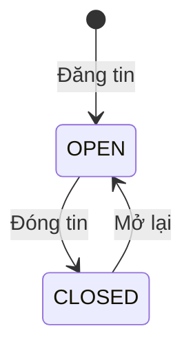

# Bài toán và nghiệp vụ

[Mục lục](../README.md) · [Đặc tả API](ENDPOINTS.md)

## Bài toán

Job Application System quản lý quy trình tuyển dụng từ lúc đăng tin đến khi có kết quả ứng tuyển. Nhà tuyển dụng đăng công việc và xử lý hồ sơ tại một nơi. Ứng viên tìm việc, nộp CV và xem trạng thái từng đơn đã gửi.

## Người dùng

**Khách** tìm kiếm việc làm theo từ khóa, địa điểm, danh mục, cấp bậc hoặc mức lương. Khách chỉ thấy các tin đang tuyển (`OPEN`).

**Ứng viên** quản lý hồ sơ cá nhân, nộp CV, xem kết quả và rút đơn của mình.

**Nhà tuyển dụng** đăng ký kèm thông tin công ty, quản lý tin và xử lý đơn ứng tuyển. Quyền quản lý gắn với người đăng tin; các nhà tuyển dụng cùng công ty không tự động có quyền trên tin của nhau.

## Quy trình tuyển dụng

1. Nhà tuyển dụng đăng ký tài khoản và công ty mới, sau đó đăng tin tuyển dụng.
2. Ứng viên tìm tin phù hợp, đăng ký/đăng nhập rồi nộp CV PDF kèm thư giới thiệu nếu cần.
3. Nhà tuyển dụng xem hồ sơ và cập nhật trạng thái đơn. Ứng viên theo dõi kết quả trong danh sách đơn đã nộp.
4. Khi ngừng tuyển, nhà tuyển dụng đóng tin. Các đơn đã nộp vẫn được giữ lại để tiếp tục xử lý.
5. Ứng viên có thể rút đơn. Nếu tin còn mở, có thể nộp lại một đơn mới.

### Tin tuyển dụng

Tin mới mặc định `OPEN`. Chỉ tin ở trạng thái này được hiển thị công khai và nhận đơn mới. Thao tác xóa chuyển tin sang `CLOSED`, giữ lại bản ghi và các đơn liên quan. Nhà tuyển dụng có thể mở lại tin đã đóng.

### Đơn ứng tuyển

Mỗi ứng viên có tối đa một đơn đang tồn tại cho cùng một tin. Rút đơn xóa bản ghi; nếu nộp lại, đơn mới bắt đầu ở `PENDING`.

| Trạng thái | Ý nghĩa |
| --- | --- |
| `PENDING` | Mới nộp |
| `REVIEWING` | Đang xem xét |
| `INTERVIEW` | Đến bước phỏng vấn |
| `OFFERED` | Đã đề nghị tuyển dụng |
| `REJECTED` | Bị từ chối |

Nhà tuyển dụng có thể gán bất kỳ trạng thái nào trong bảng, kể cả với đơn thuộc tin đã đóng. Hệ thống chưa bắt buộc thứ tự chuyển trạng thái hoặc giới hạn rút đơn theo trạng thái.

### Hồ sơ và thông tin tuyển dụng

- Ứng viên chỉ xem và sửa hồ sơ của mình; chỉ xem/rút đơn do mình nộp.
- Nhà tuyển dụng chỉ xử lý đơn thuộc tin do mình đăng.
- CV phải là PDF không rỗng, tối đa 5 MiB. Toàn bộ request nộp hồ sơ cũng bị giới hạn 5 MiB.
- Lương không âm. Nếu có cả hai đầu của khoảng lương thì `salaryMax >= salaryMin`.
- Đăng ký nhà tuyển dụng tạo công ty mới; chưa hỗ trợ gia nhập công ty đã tồn tại.

## Phạm vi chức năng

Backend cung cấp API đăng ký/đăng nhập, cập nhật hồ sơ ứng viên, tìm việc, quản lý tin và đơn ứng tuyển.

Chi tiết request/response và lỗi nằm trong [ENDPOINTS.md](ENDPOINTS.md). Cách tổ chức backend được mô tả ở [ARCHITECTURE.md](ARCHITECTURE.md); schema và cách lưu CV ở [DATABASE.md](DATABASE.md).
